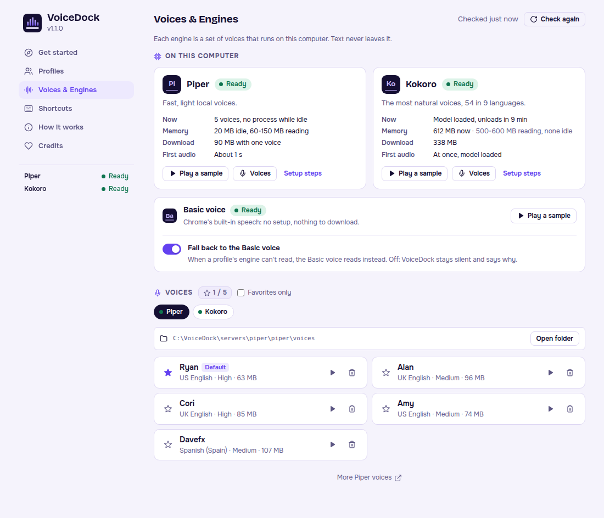

# VoiceDock

A Chrome extension that reads selected text aloud with neural voices running on your own machine.
Highlight text on any webpage, right-click it (or press `Alt+Shift+S`), and hear it read by a local engine: no cloud, no API keys, no text leaves your computer.

VoiceDock has two local engines, chosen per profile:

- **[Piper](https://github.com/rhasspy/piper)**, the light default: fast, with downloadable English voices (Node.js server on port 7477).
  It idles at about 20 MB of RAM and loads a voice (60-150 MB) only while it reads.
- **[Kokoro](https://huggingface.co/hexgrad/Kokoro-82M)**, optional: more natural, 54 voices in 9 languages, slightly slower (Python server on port 7478).
  It costs a 338 MB one-time download and about 500-600 MB of RAM while it reads.
  It runs only while you use it: the Piper server starts it on your first Kokoro read and stops it after 30 idle minutes.
  It installs with [uv](https://docs.astral.sh/uv/) on Windows, macOS and Linux (no WSL).

The Basic voice (Chrome's built-in speech) is the zero-setup choice and the automatic fallback when an engine is offline, so the extension works instantly with no server at all.
Set up Piper for natural local voices, and add Kokoro only if you want its voices and have the memory to spare.

> VoiceDock had an older name up to version 1.0.17.
> The GitHub repo was `n8watkins/piper-tts` (the old URL redirects), and settings saved by those versions carry over automatically. <!-- legacy-name -->
> See [docs/NAMING.md](docs/NAMING.md) for the name and what a rename touches.


## Screenshots





`npm run screenshots` regenerates these from WSL with headless Windows Chrome (no window opens) and mocked servers (see `tools/capture-screenshots.mjs`).
If your Windows account, Chrome path, or Windows Node path differs from the defaults, set `VOICEDOCK_WINDOWS_USER`, `VOICEDOCK_CHROME_PATH` or `VOICEDOCK_WINDOWS_NODE`.

---

## What's in this repo

```
voicedock/                      (VoiceDock)
├── extension/                  Chrome Manifest V3 extension
│   ├── manifest.json
│   ├── background.js           Service worker: menus, shortcuts, engine choice, fallback
│   ├── offscreen.html/.js      Hidden page that fetches and plays engine audio (MV3 requirement)
│   ├── tokens.css              Design tokens (palette from the mark, light and dark) and shared atoms
│   ├── src/                    Sources: popup and options (React), page.js (injected on demand: selection, player bar, hints), icons.js, shared.js
│   ├── dist/                   Bundles Chrome loads, built from src/
│   └── popup.*, options.*, icons/, fonts/
├── servers/
│   ├── piper/                  Node.js server that runs piper.exe (port 7477), plus the VoiceDock tray
│   └── kokoro/                 Python server that runs Kokoro-82M (port 7478), set up with uv
├── docs/
│   ├── API.md                  The engine API both servers implement
│   ├── NAMING.md               The VoiceDock name, alternatives, and what a rename touches
│   └── TRAY_PLAN.md            The n8voice N8 Tray module that runs both engines (built)
├── UPDATE_WINDOWS_SERVER.md    What runs where on the owner's PC, and how to update it
├── test/                       node --test: extension helpers, engine routing, Piper server contract
└── tools/                      esbuild, version bump, Windows deploy, screenshots, git hooks, icon sources
```

`servers/kokoro` was moved in from the standalone `kokoro-tts` repo with `git subtree`, so its history is kept (see [its README](servers/kokoro/README.md#history)).

---

## Development

```bash
npm install                    # installs deps and enables the git hooks
npm ci --prefix servers/piper  # Piper server deps (its contract tests need them)
npm run build                  # bundle extension/src into extension/dist
npm test                       # extension + Piper server tests (node --test) and Kokoro server tests (python3 unittest)
npm run test:e2e               # the built extension in Chromium against fake engines, with screenshot baselines (Playwright)
npm run test:e2e:isolated      # the same, in a private network, beside a real hub on 7477
npm run deploy                 # copy the built extension to the Windows folder Chrome loads
```

`npm run memory-report -- <csv dir>` builds the memory report (one self-contained HTML file with 24-hour and 7-day timelines per engine) from the memory CSV files the trays record; add `--open` to open it.
See [Memory history and reports](#memory-history-and-reports).

`npm run deploy` builds the bundles and mirrors the files the store package ships into the Windows folder that Chrome loads unpacked, `C:\Users\<you>\Extensions\voicedock`.
Override the folder with `VOICEDOCK_WINDOWS_DIR`, or the Windows user with `VOICEDOCK_WINDOWS_USER`.
An unpacked extension's ID, and so its saved settings, depends on its folder path, so keep Chrome on the folder it already loads.
It never touches a server or its downloaded binaries and voices.
Reload at `chrome://extensions` afterward.

The committed `extension/dist` bundles must always match `extension/src`.
A tracked pre-commit hook (`.githooks/pre-commit`) rebuilds and re-stages them, and CI fails if they drift.
`npm install` enables the hook through the `prepare` script, or run `git config core.hooksPath .githooks`.
The same folder holds release-kit's `commit-msg` and `pre-push` hooks.

### Chrome Web Store package

`npm run package` writes `web-store/voicedock-<version>.zip`: the files Chrome loads from `extension/`, without the React sources.
The zip is reproducible (sorted files, one fixed timestamp), so a commit always gives the same bytes.
Before writing it, `tools/package-store.mjs` refuses a manifest that breaks the store rules VoiceDock keeps: the `tabs` permission, host access beyond the two local engines, a declared content script, a custom CSP, a remote script, or a file the manifest points at that isn't packaged.
Each GitHub Release carries the same zip (`npm run release:artifacts`), with its SHA-256 checksum.
The privacy policy is [PRIVACY.md](PRIVACY.md), published at [n8builds.dev/privacy/voicedock](https://n8builds.dev/privacy/voicedock).

Commits follow Conventional Commits and releases are cut with `npm run release` (see [RELEASING.md](RELEASING.md)).
The servers are versioned separately from the extension.

---

## Setup guide

### Step 1 - Get the code

```bash
git clone https://github.com/n8watkins/voicedock.git voicedock
cd voicedock
```

### Step 2 - Load the Chrome extension

1. Open `chrome://extensions`.
2. Turn on **Developer mode** (top right).
3. Click **Load unpacked** and select the **`extension/`** folder.

The VoiceDock icon appears in the toolbar.

> **You can stop here.**
> The extension already reads with the Basic voice built into Chrome.
> A new install opens a **Get started** page that reads a sample, shows which engines run, and gives the setup steps for your OS.
> For natural local voices, set up one or both engines below.

The built React bundles are committed under `extension/dist/`, so no build step is needed just to load the extension.

### Step 3 - Set up an engine

Set up whichever engines you want; profiles that use an engine that isn't running fall back to the Basic voice.
Start with Piper: it is light and quick to install.
Kokoro is optional (see [Kokoro server](#kokoro-server) for what it costs).

#### Piper server

It costs a 90 MB download (Piper and one voice) and about 20 MB of RAM while idle.

**Windows** (PowerShell):

1. Install Node.js and Git (skip if `node -v` prints 18 or newer):

   ```powershell
   winget install -e --id OpenJS.NodeJS.LTS
   winget install -e --id Git.Git
   ```

2. Get VoiceDock (skip if you cloned it in Step 1):

   ```powershell
   git clone https://github.com/n8watkins/voicedock
   cd voicedock\servers\piper
   ```

3. Set up Piper: the Piper binary and one voice, started now and at every sign-in by a tray icon.

   ```powershell
   npm run setup
   ```

**macOS:** the same three steps, with `brew install node git` first and `cd voicedock/servers/piper`.
**Linux:** the same, with `sudo apt install nodejs npm git` first (needs Node 18 or newer: Ubuntu 24.04 has it, older releases use [nodejs.org](https://nodejs.org/)).

**How you know it worked:** the tray icon is green, and VoiceDock's popup and Settings show Piper as **Ready**.
`npm run setup` is safe to re-run.
The tray shows both engines with their live memory, starts, stops and restarts Piper, and can record memory history; see [servers/piper/README.md](servers/piper/README.md#4-start-the-server).

<details>
<summary>Manual Piper setup</summary>

1. Download the Piper build for your OS from the [Piper releases page](https://github.com/rhasspy/piper/releases/latest) (for example `piper_windows_amd64.zip`) and extract **all** of it into `servers/piper/piper/`.
   On Windows that folder holds `piper.exe`, `espeak-ng-data/` and some DLLs.
   On macOS and Linux the executable is `servers/piper/piper/piper` (or set `PIPER_BIN`).
2. Download a voice from [Piper voices on HuggingFace](https://huggingface.co/rhasspy/piper-voices/tree/main/en/en_US): both the `.onnx` model and its `.onnx.json` config (for example `en_US-ryan-high.onnx` and `en_US-ryan-high.onnx.json`), into `servers/piper/piper/voices/`.
3. Start the server:

   ```bash
   cd servers/piper
   npm ci
   npm start
   ```

   You should see `VoiceDock Piper server` and `Running at http://127.0.0.1:7477`.

Platform helpers, all from `servers/piper/`:

| Command | Does |
| --- | --- |
| `npm run start:unix` | Start on macOS or Linux. |
| `npm run start:windows` | Start in a PowerShell window. |
| `npm run start:windows:bg` / `npm run stop:windows:bg` | Start or stop a hidden background server on Windows. |
| `npm run start:windows:tray` | Start the VoiceDock tray (both engines' status and memory, Start, Stop and Restart Piper, memory report). |
| `npm run install:windows:tray` / `npm run uninstall:windows:tray` | Add or remove the tray from Windows sign-in startup. |

If another Piper server is already running, the tray shows it as external and won't stop a process it doesn't manage.

</details>

To add voices later, put each `.onnx` and `.onnx.json` pair in `servers/piper/piper/voices/` (the **Open folder** button in Voices & Engines opens it), then restart the server.
Test, star, or delete voices from **Voices & Engines**, under Voices, with Piper selected.

#### Kokoro server (optional)

Skip Kokoro if Piper's voices are good enough for you or memory is tight.
It costs a 338 MB download (once) and about 500-600 MB of RAM while it reads, and nothing when you don't use it.

**Windows** (PowerShell, from the `voicedock` folder):

1. Install uv, the Python package manager Kokoro runs on (skip if `uv --version` works):

   ```powershell
   powershell -ExecutionPolicy ByPass -c "irm https://astral.sh/uv/install.ps1 | iex"
   ```

2. Set up Kokoro: its Python packages and the model (338 MB):

   ```powershell
   powershell -ExecutionPolicy Bypass -File servers\kokoro\setup.ps1
   ```

   It ends with `Kokoro is set up.`
   Already have the model files (for example from an old WSL install)? Add `-ModelsFrom <folder>` to copy them instead of downloading.

3. Restart the Piper server (the tray's **Restart**), so it can start Kokoro.

**macOS and Linux:**

1. Install uv: `curl -LsSf https://astral.sh/uv/install.sh | sh`
2. Set up Kokoro: `servers/kokoro/setup.sh` (ends with `Kokoro is set up.`)
3. Restart the Piper server.

**How you know it worked:** VoiceDock's popup and Settings show Kokoro as **Starts when you read**.
Read with a Kokoro voice: the first read starts Kokoro (about 1 s, plus 1-2 s to load the model), later ones begin in under a second.

**How it runs:** the Piper server starts Kokoro on demand, and Kokoro stops again when nobody uses it:

| Kokoro is | Memory (Windows, measured) |
| --- | --- |
| Not started (the default) | none |
| Started, model not loaded | about 30 MB |
| Reading | about 510-625 MB |
| Idle 10 minutes: model released | about 80 MB |
| Idle 30 minutes, or a Piper read, or the Piper server stops | stopped, none |

Change the times with `KOKORO_IDLE_UNLOAD_SECONDS` (Kokoro) and `KOKORO_STOP_AFTER_SECONDS` (the Piper server).
To run Kokoro by hand instead (it then stays up), use `servers\kokoro\start.ps1` or `servers/kokoro/start.sh`; on Linux a systemd user service is also available.
See [servers/kokoro/README.md](servers/kokoro/README.md).

### Step 4 - Verify in Chrome

1. Open VoiceDock's **Voices & Engines**: each engine card shows its state from VoiceDock's server, with **Check again**.
2. On **Profiles**, edit a profile: pick the engine pill, then a voice, and press **Test**.
3. The popup's dock strip shows every engine's state.

### What the engine states mean

| State | Means | Fix |
| --- | --- | --- |
| **Ready** | It answers now. | Nothing. |
| **Starts when you read** (Kokoro) | Set up; VoiceDock's server starts it on your first Kokoro read. | Nothing. |
| **Installed but not running** | Set up, but VoiceDock's server is not running, or keeps the engine off for now (low memory, repeated crashes). | Tray icon, then **Start** (or `npm start` in `servers/piper`). Kokoro still stuck: run `setup.ps1` or `setup.sh` again and **Restart** from the tray icon. |
| **Not installed** | Not set up on this computer. | Follow the steps above. |

In the extension, **Set up** and **How to start** open a guided panel with the same steps per OS, copy buttons, and a live check that turns green when the engine is ready.

---

## Usage

**Read text aloud:** highlight text, right-click, and choose **Read selection** (or press `Alt+Shift+S`).
Stop with `Alt+Shift+S` again, the popup's **Stop** button, or right-click → **Stop reading**.

**Keyboard shortcuts:**

- Read / stop selected text: `Alt+Shift+S`
- Pause / resume: `Alt+Shift+D`

Rebind them at `chrome://extensions/shortcuts` (the Shortcuts tab links there).

**Profiles:** each profile stores an engine (Piper, Kokoro, or the Basic voice), a voice, a speed, and a volume.
Switch profiles with the pills in the popup, or use **Read as…** in the right-click menu.

**Voices:** in the popup, press **Reading with** to pick a voice: engine pills on top, then that engine's voices with search, a language filter, favorites and a sample button.

**While reading:** the on-page overlay shows progress and lets you nudge speed and volume for the current reading without changing the profile.

---

## Settings page

| Tab | What you can do |
| --- | --- |
| **Get started** | Opens on a new install: read a sample, see which voices run here, and set up Piper or Kokoro step by step. |
| **Profiles** | Up to 5 profiles, each with an engine and voice (engine pills, then a voice list), speed and volume. |
| **Voices & Engines** | A card per engine with its state, memory and time to first audio; guided setup per OS with a live check; the Basic voice fallback; each engine's voices with samples, up to 5 favorites per engine, and deleting Piper voices from disk. |
| **Shortcuts** | The read and pause shortcuts, with a link to change them in Chrome. |
| **How it works** | Where your text goes, in five lines. |
| **Credits** | Piper, Kokoro and the other open-source pieces. |

---

## Engines compared

| | Basic voice | Piper | Kokoro |
| --- | --- | --- | --- |
| Setup | None | `npm run setup` (Node.js) | Optional: uv, then `setup.ps1` or `setup.sh` |
| Download | None | Piper plus about 60-120 MB per voice | 338 MB, once |
| RAM | None extra | About 20 MB idle, plus 60-150 MB while reading | About 45 MB idle, 300-700 MB while the model is loaded |
| Needs a local server | No | Yes (port 7477) | Yes (port 7478) |
| Sends text to a hosted API | No | No | No |
| Voices | Your OS voices | Downloaded `.onnx` voices (8 installed here) | 54 built-in voices, 9 languages |
| Sound | Robotic | Good | Most natural |
| Warm latency, one sentence (measured here) | Instant | about 1.15 s | about 1.5 s |
| Manage voices in the app | No | Install, test, favorite, delete | Test, favorite |
| Speed control | Yes | Yes, live | Yes, live |
| Volume | Up to the browser max | Up to 2× gain | Up to 2× gain |
| When the engine is down | Always available | Falls back to the Basic voice (if on) | Falls back to the Basic voice (if on) |

---

## How it works

```
Highlight text → right-click "Read selection" (or Alt+Shift+S)
       ↓
background.js: which engine does the active profile use?
       ↓                                   ↓
 Piper or Kokoro, server online      browser engine, or server offline
       ↓                                   ↓       (fallback on: page shows a short note)
 offscreen.js splits text into chunks    chrome.tts.speak()
       ↓
 POST /tts → the hub on 127.0.0.1:7477: Piper reads there; Kokoro is started on demand and reached through it
       ↓
 WAV audio → Web Audio API, next chunk prefetched while this one plays
```

Manifest V3 service workers can't play audio, so engine audio is played by an **offscreen document**, a hidden page that can use `new Audio()`.

VoiceDock has no content script on every site.
When you read from a page (the right-click menu or the shortcut), Chrome grants the extension `activeTab` for that tab, and `background.js` injects the page script (`dist/page.js`, built from `src/page.js`) into it with `chrome.scripting` for the selection, the player bar and short hints.
The player bar shows on the page you started reading from; the popup and the shortcuts control playback from anywhere.
Pages Chrome doesn't let extensions script (`chrome://` pages, the Chrome Web Store, the PDF viewer) get no player bar; where Chrome offers the right-click menu there (the PDF viewer), it still reads.
Both servers implement the same small API, documented in [docs/API.md](docs/API.md).

---

## Memory history and reports

Both engine servers report their own memory in `GET /health` (see [docs/API.md](docs/API.md#get-health)), and nothing there loads a model.
A tray can record those numbers once a minute into CSV files, one per day:

```
timestamp,engine,rss_mb,model_loaded,event,detail
2026-11-02T18:05:12Z,kokoro,581.2,yes,load,
2026-11-02T18:05:19Z,kokoro,581.2,yes,speak,af_heart
2026-11-02T18:06:00Z,kokoro,583.0,yes,sample,
```

`event` is `sample`, `load`, `unload`, `speak`, `start`, `restart` or `offline`, and `engine` is `piper`, `kokoro` or `wsl` (the WSL VM, where a tray can read it without waking WSL).
Build the report from a folder of these files with:

```bash
npm run memory-report -- /mnt/c/Users/<you>/AppData/Roaming/VoiceDock/memory --open
```

It writes `memory-report.html` into that folder: a timeline per engine for the last hour, 24 hours and 7 days with model loads, releases, reads and restarts marked, plus peak, average and idle memory.
The file is self-contained (inline SVG, no network), so it can be kept or shared as is.

---

## Privacy and security

See [PRIVACY.md](PRIVACY.md) for the full privacy policy.

VoiceDock sends selected text only to servers on your own machine.
The Basic voice asks Chrome for a voice that runs on this device (an operating system voice); only when the system has none does Chrome use its own default, which in Google Chrome can be an online Google voice.
Both servers bind to `127.0.0.1` and reject requests from web pages: only requests from a Chrome extension, or with no `Origin` header at all (curl, scripts), are served.
So a site you visit can't use your local engines.

The servers have no authentication: the loopback bind is what keeps other machines out.
Keep the default `HOST` (Piper) and `KOKORO_HOST` (Kokoro) of `127.0.0.1`.
If either is set to anything other than loopback (`127.0.0.1`, `::1` or `localhost`), for example `0.0.0.0`, the server still starts but logs a warning, and its `/health` reports `"exposed": true` with the address in `listen`.
Anyone who can reach that address can then use the engine.

The Kokoro server runs one synthesis at a time.
Requests that arrive together, or while the model is loading or being released, wait their turn instead of failing.

---

## Troubleshooting

**The right-click menu doesn't appear.**
Make sure the extension is loaded and enabled at `chrome://extensions`.

**The shortcut does nothing.**
Open `chrome://extensions/shortcuts` and check that VoiceDock's shortcuts are set.
Chrome leaves a suggested shortcut unassigned when it is already taken, which is why the read shortcut moved from `Alt+Shift+R` (Chrome no longer assigns it) to `Alt+Shift+S` in 1.2.

**An engine shows Offline.**
Piper: run `npm start` (or the tray) in `servers/piper/` and check that port 7477 is free.
Kokoro: it starts on demand through VoiceDock's server, so check that first; then check that `servers/kokoro` was set up (`setup.ps1` or `setup.sh`), and look in `servers/piper/logs/kokoro.log` and at `http://127.0.0.1:7477/hub/events`.
Then press **Check again** on Voices & Engines.

**A profile sounds like the Basic voice.**
Its engine could not read and the fallback kicked in. The player bar says so in an amber note that stays until you dismiss it, with one button to the engine's setup (a red note means nothing could read).
Start the engine, or turn the fallback off in Voices & Engines to get an error instead.

**No audio at all.**
Open DevTools (F12 → Console) on the page and look for errors.
Common causes: no Piper voice downloaded, a missing `piper.exe`, or Kokoro not set up (run `setup.ps1` or `setup.sh` in `servers/kokoro`).

---

## Roadmap

- [x] Basic voice (no setup)
- [x] Local Piper server, offscreen playback, sentence chunking with prefetch
- [x] Named profiles, voice management, keyboard shortcuts, on-page overlay
- [x] Windows tray and one-command Piper setup
- [x] VoiceDock tray: both engines with live memory, memory history and a memory report
- [x] Kokoro as a second engine, chosen per profile (1.1)
- [x] One N8 Tray module that runs both engines, `n8voice` ([docs/TRAY_PLAN.md](docs/TRAY_PLAN.md))
- [ ] Rename the repo and the Chrome Web Store listing ([docs/NAMING.md](docs/NAMING.md))
- [ ] macOS and Linux real-machine verification of the Piper server

---

## Credits

- [Piper](https://github.com/rhasspy/piper): fast, offline neural TTS by rhasspy, and the [Piper voices](https://huggingface.co/rhasspy/piper-voices).
- [Kokoro-82M](https://huggingface.co/hexgrad/Kokoro-82M): open-weight TTS model by hexgrad (Apache 2.0).
- [kokoro-onnx](https://github.com/thewh1teagle/kokoro-onnx): runs Kokoro with ONNX Runtime.
- Chrome Offscreen Documents API (Manifest V3).

MIT License: free to use, fork, and share.
